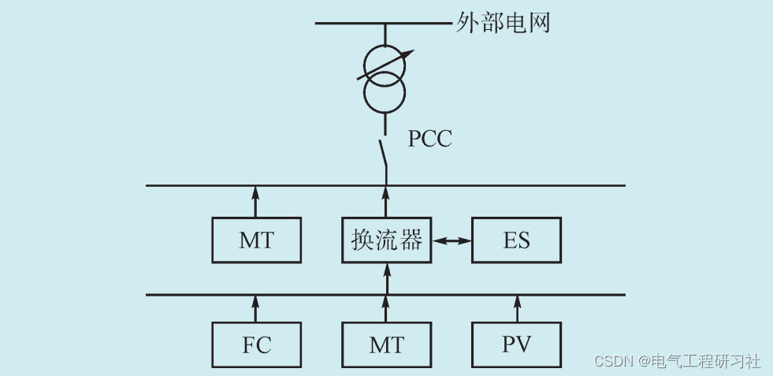
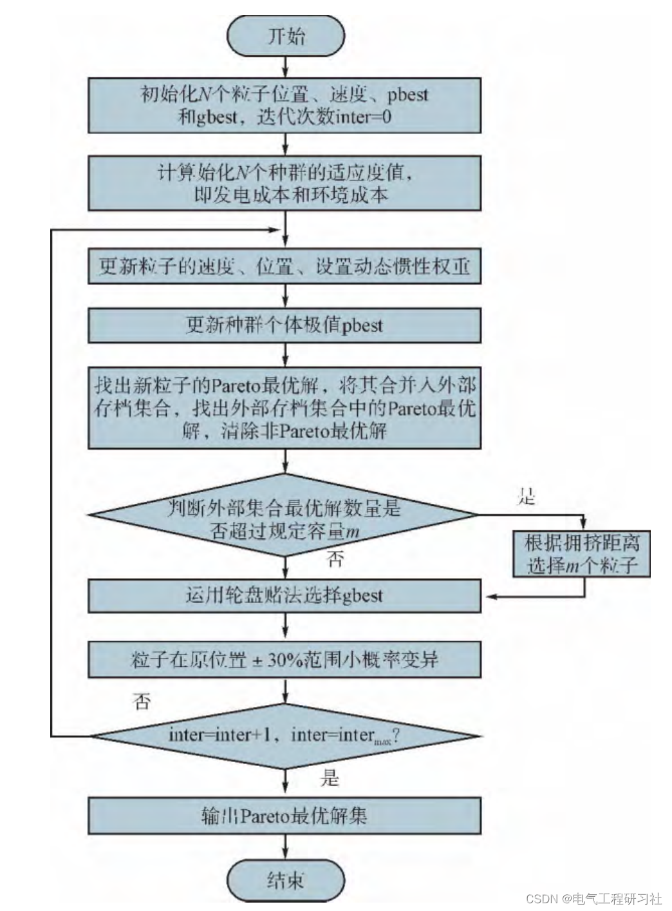
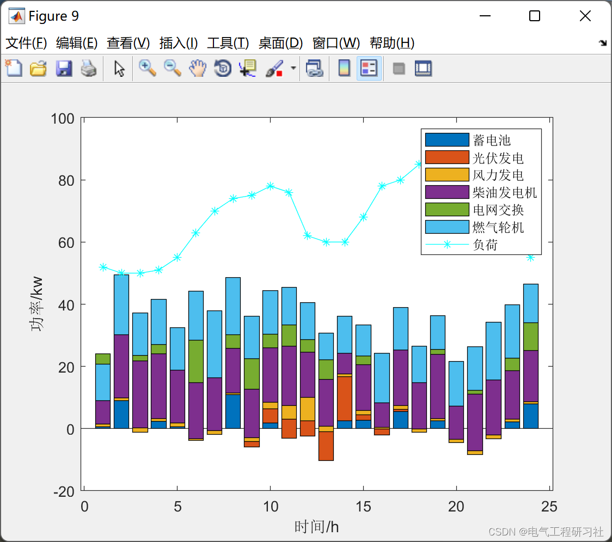
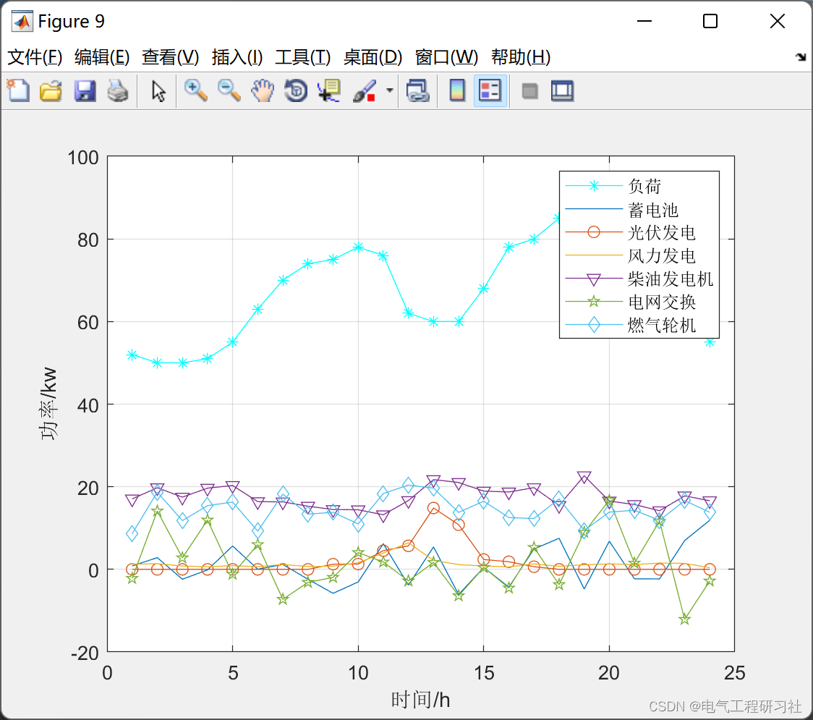
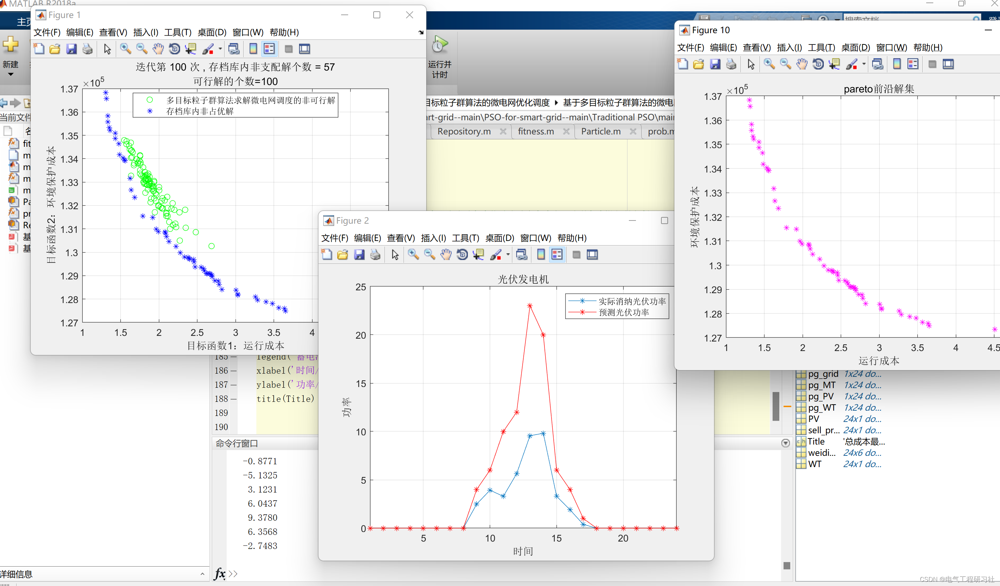
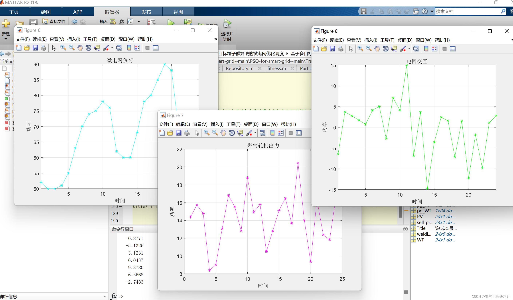
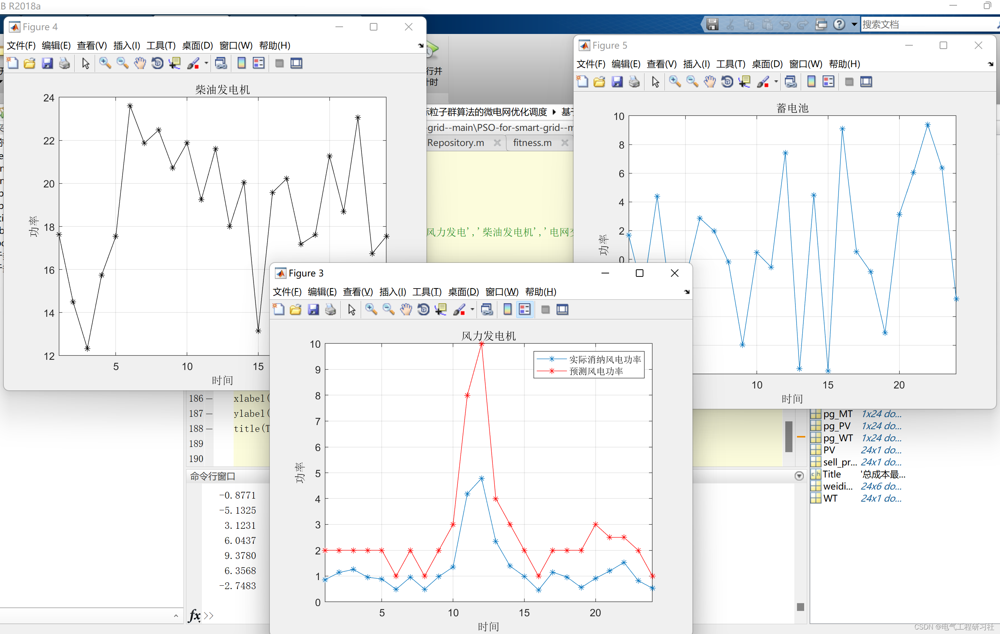
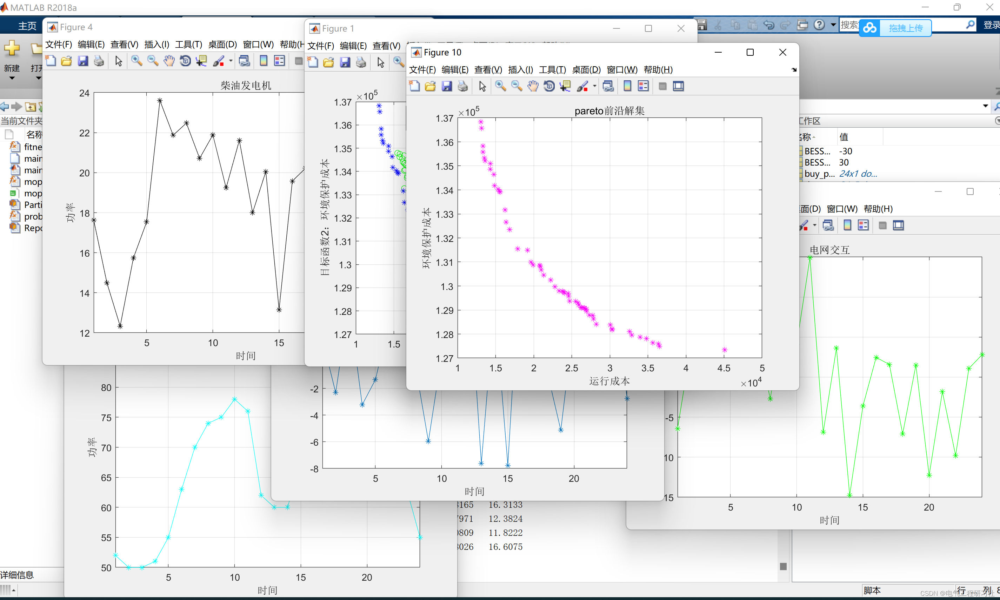

# Optimization Dispatch of Microgrid Based on Multi-Objective Particle Swarm Algorithm (Matlab Code)

​  
Editor
Editor
Abstract: A coordinated microgrid optimization dispatch model that balances economic and environmental concerns is proposed. This study focuses on the optimization of a microgrid system composed of photovoltaic cells, wind turbines, micro gas turbine, diesel generators, and batteries. Under the constraints of the system, a multi-objective optimization dispatch model for the microgrid is established, which includes operational costs, interruptible load compensation costs, and pollution treatment expenses. The microgrid's optimization dispatch problem is solved using the Multi-Objective Particle Swarm Optimization (MOPSO) algorithm. Simulation results indicate that this model offers guidance for the optimization of microgrid systems.
Microgrid (Microgrid) as an important component of smart grid, on the one hand, microgrid provides distributed power supply (Distributed Power Supply).
Generation, DG), load, energy storage devices, and control units are effective carriers. They fully leverage the economic, environmental, and flexible advantages of DG to provide high-quality power quality for electricity users, ensuring safe and reliable power supply. On the other hand, microgrids operate with great flexibility; they can either be integrated into the main grid or operate in an islanded mode when there is a fault in the grid system, thus safeguarding the power supply to critical loads.
1. Microgrid Power System with Renewable Energy
Editor
Figure 1: Microgrid system structure
1.1 Solar Photovoltaic Cells The output power of photovoltaic cells is related to the intensity of light, and photovoltaic cells generally operate in a maximum power point tracking (MPPT) mode. The output power can be expressed as [10]
Among them, PV is the actual power output of PV; ζ is the solar light intensity; ηm is the efficiency in maximum power point tracking mode; Ap is the area of the photovoltaic panel; ηp is the efficiency of the photovoltaic cell; θ is the incident angle of light.1.2 Wind turbine The output power of a wind turbine is related to the wind speed, and its power output model can be expressed as:
v_{\mathrm{co}} \\ \frac{v^{3}-v_{\mathrm{ci}}^{3}}{v_{\mathrm{r}}^{3}-v_{\mathrm{ci}}^{3}} P_{\mathrm{r}} & v_{\mathrm{ci}} \leqslant v \leqslant v_{\mathrm{r}} \\ P_{\mathrm{r}} & v_{\mathrm{r}} \leqslant v \leqslant v_{\mathrm{co}} \end{array}\right.">  
Among them, PWT and Pr represent the actual power and rated power of WT respectively; vci, gco, vr represent the cut-in wind speed, cut-out wind speed, rated wind speed of the wind turbine, which are respectively set as 3 m/s, 25 m/s, 14 m/s in this paper. 1.3 Micro gas turbine In this paper, a controllable micro gas turbine is added to the microgrid, whose fuel cost is related to its own work efficiency. The expression for MT fuel cost is [8].
In the product, FDE represents the fuel cost of DE; PDE stands for the output power of DE; α, β, γ are coefficients for the fuel cost of DE, and in this paper, they are set as α=6, β=0.12, γ=1.5. Battery is a type of energy storage that can track changes in wind and solar power output to charge or discharge, playing a buffering role in the grid to improve the reliability and continuity of power supply. When the total output power of DG exceeds the total load, ES charges, otherwise, ES discharges. The charging and discharging status of the battery is represented by the following two equations:
The first equation represents charging, and the second represents discharging.
Here, ES(Bt) and ES(Bt-1) represent the capacity of the battery at time t and t-1 respectively; Ptotal(t) represents the total output power of micro-power sources at time t; Pload(t) represents the total system load at time t; ηinv and ηsb represent the efficiency of the inverter and the charging/discharging efficiency of ES respectively.

2. Multi-objective Mathematical Model for Optimal Operation of Microgrid
When the microgrid operates in island mode, considering system constraints, a multi-objective optimization model is established to minimize the operational cost of the microgrid and the emission cost of pollutants.
2.1 Operational Cost
The operational cost of the microgrid mainly considers the operating cost and the compensation cost for interruptible loads. Therefore, under conditions that meet system equations and inequality constraints, the operation cost of the microgrid is minimized, i.e.:
In which, T is the number of time periods in the dispatch cycle of the microgrid; N is the number of types of micro-power sources; COit is the generation cost of micro-power source i at time t; IRt is the interruptible cost of the microgrid at time t; Pi,t is the power generation of micro-power source i at time t.
2.1.1 Generation Cost.
The main considerations for the operational cost of the microgrid include fuel costs, depreciation costs, and maintenance costs. Since PV and WT are clean energy sources, they do not consume fossil fuels during operation, so their fuel costs are not considered, i.e.:
In the formula, CFi,t represents the fuel cost of micropower i at time t; IVi,t denotes the depreciation cost of micropower i converted to a unit time; and OMi,t is the maintenance cost of micropower i at time t.
Among them, CINS, i is the installation cost of the micro power unit i; Pr, i is the rated power of the micro power unit i; fc, i is the capacity factor of the micro power unit i; d is the interest rate or depreciation rate; m is the service life of the micro power unit.
Among them, Km,i is the unit operation and maintenance cost of micro power source i.
2.2 Environmental Costs The environmental costs primarily consider the treatment costs for CO2, SO2, and NOX emissions from the unit [11]. Since PV and WT are clean energy sources, they do not produce polluting gases during operation, thus the environmental costs associated with PV and WT are not considered. The objective function is to minimize the environmental cost, expressed as:
Among them, the environmental cost of CE; K represents the type of pollutant emissions (CO2, SO2 and NOX); αj is the unit cost for treating the jth pollutant, $/kg; βij is the emission coefficient of the jth pollutant when outputting Pi kWh of electricity under different power generation methods, g/(kW·h). 2.3 Constraints 2.3.1 Micro-power generation capacity constraints
In the formula, and represent the lower and upper limits of micro power output respectively. 2.3.2 Microgrid Power Balance Constraint
In the formula, Pi and PL represent the output power of micropower i and the load of microgrid respectively; PBS represents the charging and discharging power of batteries. When PBS > 0, it indicates that the batteries are discharging, and when PBS < 0, it indicates that the batteries are charging.
In the formula, and represent the transmission power lower and upper limits of the microgrid lines respectively. 2.3.4 Battery Storage Operational Constraints
In the formula, denotes the minimum and maximum charging/discharging power of the battery; denotes the minimum and maximum capacity of the battery. 3 Optimization scheduling of microgrid with multi-objective particle swarm algorithm is described in Section 5.
3.1 Multi-objective Optimization Problems
Figure 2: Multi-objective Optimization Scheduling Process
4 Case Simulation Results
Edit
Edit
Edit
Edit
5 Matlab Code Implementation + Data + Article Explanation
This article only showcases a portion of the code. The complete code can be found in the linked folder.
%% Target function
6. End Note: The references to theoretical literature are from online sources, and if any infringement is found, please contact the blogger for removal.
​  

## Images

<!-- PAYMENT_BLOCK -->

## Get this dataset

- Payment link (Stripe): [Buy now](https://buy.stripe.com/3cs8yP7sY87d0vu9AB)
- Payment QR code: 

<!-- /PAYMENT_BLOCK -->
